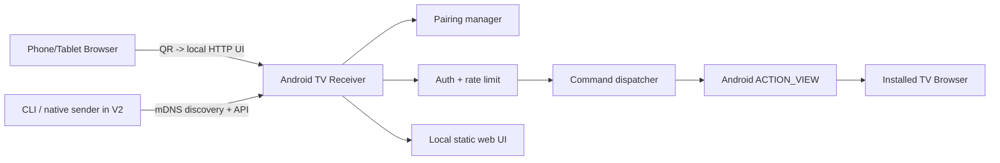

# System architecture

[Русский](../docs/ru/architecture/system.md)

## Component responsibility
- **TV Kotlin app**: lifecycle, NSD advertiser (V2), HTTP endpoint and static UI, pairing approval, encrypted-at-rest token storage as supported, URL dispatcher, TV status.
- **Web sender**: responsive UI, pairing flow, paste URL, request state, reconnect/error affordances; served by receiver in V1 to avoid remote HTTPS -> local HTTP browser restrictions.
- **Protocol**: HTTP JSON in V1, versioned envelope and stable error codes; events/WebSocket only when justified by UI lifecycle.
- **Go CLI (V2)**: DNS-SD discovery, pairing or token import via secure local flow, selection by ID/name, commands.

## Platform caveats
- Native Android TV app installation required for guaranteed custom receiving behavior.
- A webpage cannot generally perform arbitrary mDNS scans, so V1 does not depend on browser discovery.
- AP/client isolation or VLAN firewall can prevent LAN reachability even with QR.
- Receiver-hosted HTTP protects from browser mixed-content issues for the web sender but **does not encrypt traffic**; assess local HTTPS with device-specific trust in a later security milestone.
- Sites requiring login must authenticate separately on TV. ACTION_VIEW may open native apps instead of web pages.

## Desired Kotlin modules
`core/network`, `core/protocol`, `core/security`, `features/pairing`, `features/open_url`, `features/receiver_home`, `features/settings`.

## Design principles
Keep transport/auth/commands separated; avoid introducing generalized plugins before multiple real receiver implementations exist. Side effects behind testable interfaces. Monotonic request IDs, idempotency consideration for repeated command submissions.
