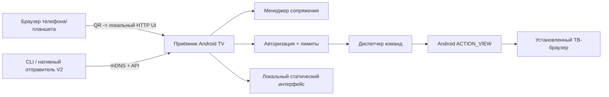

# Архитектура системы

[English](../../../architecture/system.md)

## Ответственность компонентов
- **ТВ-приложение Kotlin**: жизненный цикл, NSD-реклама (V2), HTTP и статический интерфейс, подтверждение сопряжения, защищённое хранение токенов с шифрованием при поддержке, диспетчер URL, статус ТВ.
- **Веб-отправитель**: адаптивный интерфейс, сопряжение, вставка URL, состояния запросов, восстановление соединения и ошибки; в V1 раздаётся приёмником, чтобы не зависеть от ограничений удалённый HTTPS → локальный HTTP.
- **Протокол**: HTTP JSON в V1, версионированная структура и стабильные коды ошибок; события/WebSocket — только при обосновании жизненным циклом UI.
- **Go CLI (V2)**: DNS-SD, сопряжение или импорт токена через безопасный локальный сценарий, выбор по ID/имени, команды.

## Ограничения платформы
- Для гарантированного собственного поведения нужна установка нативного Android TV-приложения.
- Страница обычно не может произвольно сканировать mDNS; V1 не зависит от поиска из браузера.
- Изоляция клиентов/AP и firewall VLAN могут блокировать LAN даже с QR.
- Раздача HTTP с приёмника избегает mixed-content для отправителя, но **не шифрует трафик**. Локальный HTTPS с индивидуальным доверием — отдельный будущий этап безопасности.
- Сайты требуют отдельного входа в аккаунт на ТВ. ACTION_VIEW может открыть нативное приложение вместо страницы.

## Желаемые Kotlin-модули
`core/network`, `core/protocol`, `core/security`, `features/pairing`, `features/open_url`, `features/receiver_home`, `features/settings`.

## Принципы
Разделяйте транспорт, авторизацию и команды. Не вводите общую систему плагинов до появления нескольких реальных реализаций приёмника. Побочные эффекты скрывайте за тестируемыми интерфейсами. Монотонные ID запросов; учитывайте идемпотентность повторных команд.
